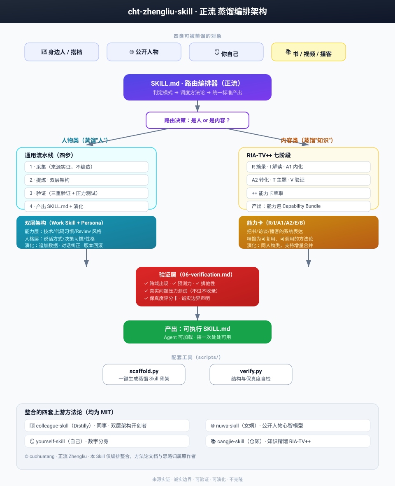

# cht-zhengliu-skill · 蒸馏总编排（正流 / Zhengliu）

把**同事、公开人物、你自己、书籍/视频/播客**四类对象，统一蒸馏成可执行的 Agent Skill。
整合四套开源方法论，提供模式路由、双层架构、三重验证与版本演化——**装一次、处处可用**。

> ⚠️ 注：题面里的"仓吉"是"**仓颉**"的笔误（Cangjie，传说中造字的仓颉）。
> 仓颉.Skill 蒸馏的是"内容/知识"，与前三个蒸馏"人"的技能不同类，互为补充。

## 四种模式

| 模式 | 蒸馏对象 | 上游方法论 | 产物 |
| --- | --- | --- | --- |
| `colleague` | 身边人 / 工作搭档 | [colleague-skill](https://github.com/titanwings/colleague-skill)（Distilly） | Work Skill + Persona |
| `nuwa` | 公开人物 / 思想家 | [nuwa-skill](https://github.com/alchaincyf/nuwa-skill) | 五层心智模型 |
| `yourself` | 你自己 | [yourself-skill](https://github.com/notdog1998/yourself-skill) | Self Memory + 5 层人格 |
| `cangjie` | 书 / 长视频 / 播客 | [cangjie-skill](https://github.com/kangarooking/cangjie-skill) | 能力包（RIA-TV++） |

## 架构总览

正流是一个**编排器**：判定对象类型 → 路由到正确方法论 → 按统一标准产出可被 Agent 加载的 Skill。
人物类走"双层架构"，内容类走"RIA-TV++"，两者共用同一个**验证层**与**演化层**。



> 高清图见 [`assets/architecture.svg`](assets/architecture.svg)。

## 四步工作流

无论哪种模式，都走这条统一流水线（详情见 `references/00-overview.md`）：

| 步骤 | 动作 | 关键约束 |
| --- | --- | --- |
| **1 · 采集 Collect** | 按模式选择数据源（聊天/邮件/文档、公开著作/访谈、书/播客…） | 来源实证，不编造 |
| **2 · 提炼 Extract** | 人物类拆成「能力层 + 人格层」，内容类走 RIA-TV++ 七阶段 | 可复用单元化 |
| **3 · 验证 Verify** | 三重验证（跨域出现 / 预测力 / 排他性）+ 真实问题压力测试 | 不过不收录 |
| **4 · 产出&演化 Emit** | 写入 `SKILL.md`，支持追加数据增量合并、对话纠正、版本回滚 | 装一次处处可用 |

## 快速开始

```bash
# 安装（目录名必须严格等于 name 字段：cht-zhengliu-skill）
git clone https://github.com/cuohuatang/cht-zhengliu-skill ~/.codebuddy/skills/cht-zhengliu-skill
# 或 Claude Code / Codex / Cursor 等的 skills 目录

# 一行命令（skills 兼容安装器）
npx skills add cuohuatang/cht-zhengliu-skill
```

装好并验证（目录名必须严格等于 `name` 字段）：

```bash
grep -rl "^name: cht-zhengliu-skill" ~/.codebuddy/skills/*/SKILL.md
```

装好后对 Agent 说：

```
> 用正流帮我蒸馏一个同事：把飞书聊天记录 + 他的设计文档喂进去
> 用正流蒸馏芒格的心智模型
> 用正流造我的数字分身（导入微信聊天记录 + 日记）
> 用正流把《穷查理宝典》蒸馏成一组可执行的 Skill
```

## 目录结构

```
cht-zhengliu-skill/
├── SKILL.md                      # 入口（name + description frontmatter）
├── README.md
├── LICENSE                       # MIT
├── references/
│   ├── 00-overview.md            # 总览与路由决策表
│   ├── 01-person-layer.md        # 人物通用层（双层架构 + 演化）
│   ├── 02-colleague-mode.md      # 同事模式
│   ├── 03-nuwa-mode.md           # 女娲模式
│   ├── 04-yourself-mode.md       # 自己模式
│   ├── 05-cangjie-mode.md        # 仓颉模式
│   ├── 06-verification.md        # 三重验证 + 保真度评分卡
│   └── templates/
│       ├── skill-template.md     # 生成 Skill 骨架模板
│       └── persona-template.md   # 人格结构模板
├── scripts/
│   ├── scaffold.py               # 一键生成蒸馏 Skill 骨架
│   └── verify.py                 # 结构与保真度自检
└── assets/
    └── architecture.svg          # 蒸馏编排架构图（README 内嵌）
```

## 脚本

```bash
# 生成骨架
python3 scripts/scaffold.py --slug karpathy --name "Karpathy" --mode nuwa --out ./skills

# 结构自检（返回 0 通过，1 缺失）
python3 scripts/verify.py ./skills/karpathy-skill
```

## 核心原则

1. **来源实证**：结论必须有原材料支撑，不编造。
2. **诚实边界**：每个产物必须写明"做不到什么"。
3. **可验证**：观点过三重验证，技能过真实问题压力测试。
4. **可演化**：支持追加数据、对话纠正、版本回滚。
5. **不克隆**：蒸馏的是认知镜像/方法论，不是替代真人。

## 许可证与归属

MIT License。整合自以下 MIT 开源项目（使用时请保留署名）：

- [titanwings/colleague-skill](https://github.com/titanwings/colleague-skill)（同事 / Distilly）
- [alchaincyf/nuwa-skill](https://github.com/alchaincyf/nuwa-skill)（女娲）
- [notdog1998/yourself-skill](https://github.com/notdog1998/yourself-skill)（自己）
- [kangarooking/cangjie-skill](https://github.com/kangarooking/cangjie-skill)（仓颉）

© cuohuatang · 正流 Zhengliu
